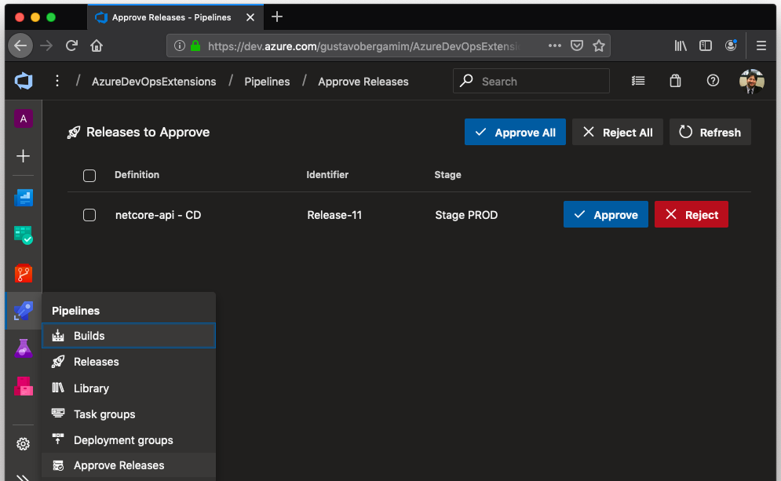
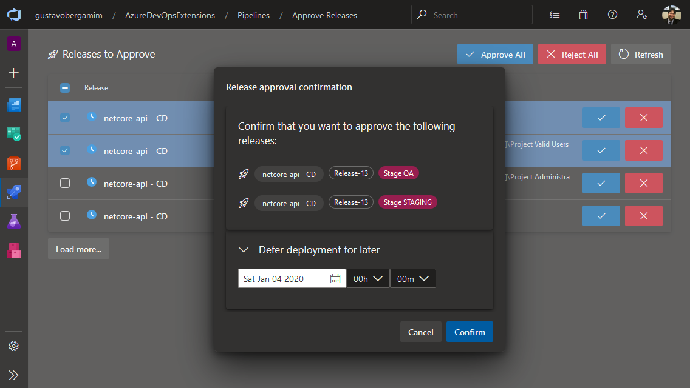

# Releases Approval Dashboard

This extension allows you to easily view classic releases and YAML pipeline stages that are pending approval for your user, allowing you to approve them directly from a simple grid view. You can approve them one by one or in batch.

## Requirements

Starting with version 2.0.0, this extension uses Azure DevOps REST API version 7.2. It works with Azure DevOps Services and with Azure DevOps Server versions that support REST API 7.2. Older on-premises servers (Azure DevOps Server 2022 and earlier, TFS) are no longer supported. On those servers, use version 1.x of the extension.

Starting with version 2.1.0, the extension also asks for the **Build (read and execute)** scope, used by the **YAML pipelines** tab to approve and reject stages. An organization administrator has to approve the new permission before the update is applied. The same version drops the **Agent pools (read)** scope, which the extension didn't use, and the separate **Build (read)** scope, which **Build (read and execute)** already includes.

## Getting started

1. From the Pipeline hub, select the **Pending Approvals** option
2. The hub opens on the **YAML pipelines** tab (see [YAML pipelines](#yaml-pipelines)), or on the last tab you used. The **Classic releases** tab will display all releases pending approval
3. From each release, you can **approve** or **reject**
   **Note:** If you prefer, you can select more than one release for approval (or rejection) and select **Approve All** (**Reject All**) button.
4. If you want/need, You can schedule deployment for later with deferred deployment feature:

    

    > **Important!!!**
    >
    > The date picker field in deferred deployment section has a know issue. The component doesn´t appear with selected Azure DevOps theme. This occurs because this component is from Office UI library and I don´t know how to apply Azure DevOps themes to this library yet. This is a backlog item for next releases.

## YAML pipelines

The **YAML pipelines** tab lists the stages of multi-stage YAML pipeline runs, in the current project, that are waiting for your approval. These are the approvals configured as an **Approvals** check on environments, variable groups and other protected resources, including approvals assigned to a group you belong to.

1. Each row shows the pipeline, the run (with a link to it), the stage, the branch, who the approval is waiting on and for how long. Hover the status to read the approval instructions.
2. Filter the list by pipeline, stage or branch.
3. Approve or reject a single stage from its row, or select several and use **Approve Selected** or **Reject Selected**. The comment you type is saved on the approval.
4. When a newer run of the same pipeline and branch is waiting at the same stage, the row shows **Newer run waiting**, and the confirmation panel warns you before you approve the older run.

The tab doesn't list approvals you can't act on (for example, when the person who started the run can't approve it), approvals from the `ManualValidation` task (the API returns them without the run) or approvals from other projects.

## Feature Backlog

This release has minimal functionality to perform approvals, but we are working on more features and enhancements to refine and complete the extension.

Here are some features we're working on. Feel free to suggest any other feature.

* **Grid filters:** allows to filter pending approvals by definition, identifier, status or stage/environment.
* **Sortable columns:** allows to sort items.
* **UI improvements**:
  * add theme support for deferred deployment date picker.
  * add stage grouping (Issue #30)

## Pipeline

## Contributors

Special thanks to Vinicius Moura (Microsoft MVP) for always helping with Azure DevOps related questions and ideas.

## Contribute

This extension is free, but if you enjoyed the work and would like to help the developer stay up:

